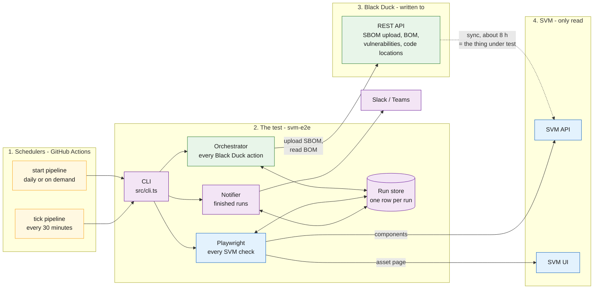
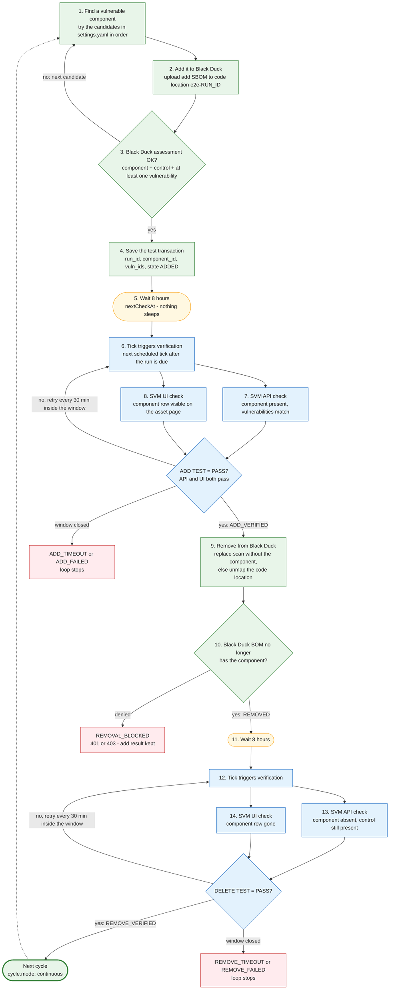
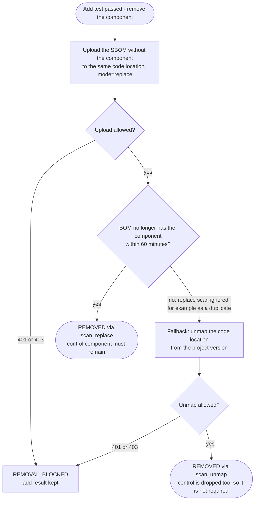
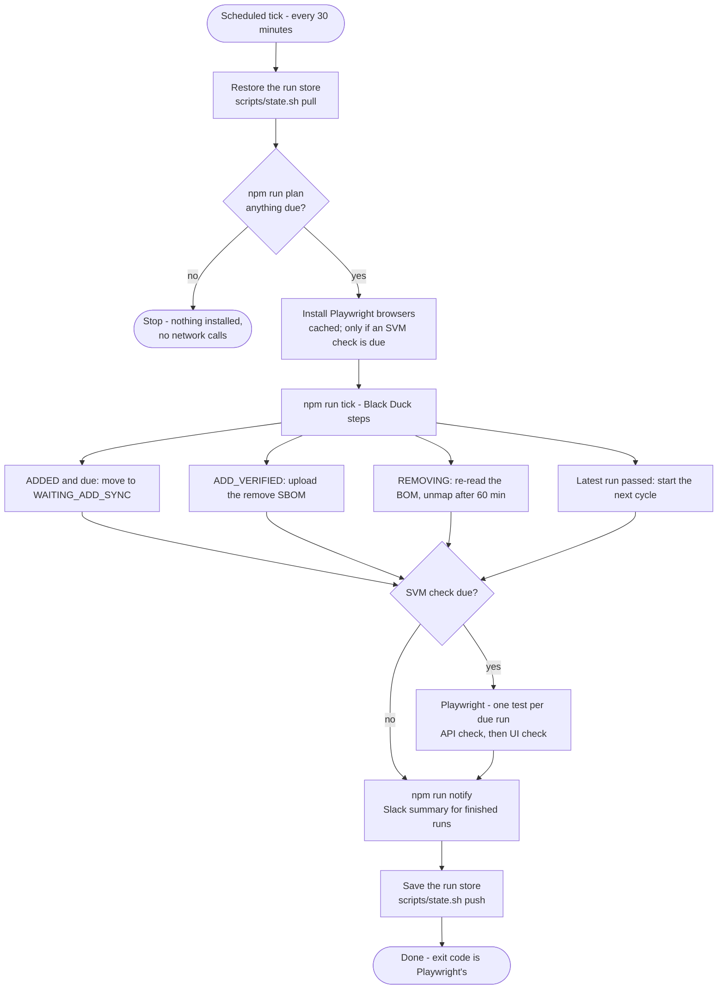
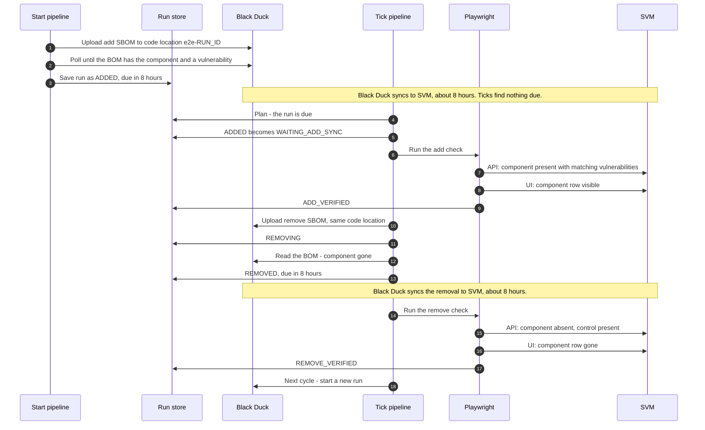
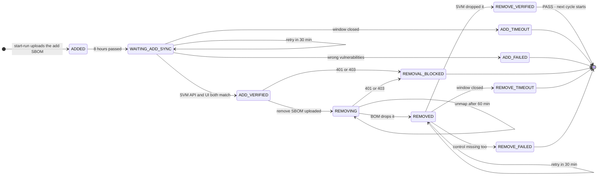

# Architecture

## Goal

> The diagrams below are Mermaid, which GitHub renders. If your viewer does not, static copies are in
> [diagrams/](diagrams): [overview](diagrams/overview.png), [run flow](diagrams/run-flow.png),
> [removal](diagrams/removal.png), [tick](diagrams/tick.png), [run timeline](diagrams/run-timeline.png)
> and [state machine](diagrams/state-machine.png). To regenerate them after editing a diagram:
> `npx @mermaid-js/mermaid-cli -i diagram.mmd -o diagram.png`.

Prove that a component and vulnerability added in Black Duck appear in SVM within the sync window
(about 8 hours), and that a removal shows up too, **without ever holding BOM delete rights**.

## The big picture

The test checks that **Black Duck's data reaches SVM**, so it only ever _writes_ to Black Duck and
only ever _reads_ from SVM. The sync between them (about 8 hours) is the thing under test.

**How to read it.**

- **1. Schedulers.** Two small GitHub Actions pipelines drive everything. `start` creates a run;
  `tick` moves existing runs forward. Neither ever waits for the 8-hour sync.
- **2. The test.** One CLI dispatches to two halves: the **Orchestrator** does every Black Duck
  action, and **Playwright** does every SVM check. They never call each other; they only read and write
  the **run store**, which is the single source of truth about where each run is.
- **3. Black Duck** is only written to (SBOM uploads) and read back (BOM, vulnerabilities).
  **4. SVM** is only read. The dotted arrow is Black Duck's own sync, which this test
  exists to prove.
- **Why two halves.** A run lasts 16-20 hours, so it cannot be one Playwright test. Playwright still
  owns the SVM checks so every check gets traces, screenshots and JUnit/HTML reports.

## One run, end to end

This is the team's flowchart, with the removal done through scans. Green boxes are the Black Duck
side, blue boxes are the SVM side, and the amber boxes are where the run waits.

**How to read it.**

| Steps        | What happens                                                                                                                                                                                                                                 | Who does it                   |
| ------------ | -------------------------------------------------------------------------------------------------------------------------------------------------------------------------------------------------------------------------------------------- | ----------------------------- |
| 1-4          | Pick a component, add it, check Black Duck really reports it with a vulnerability, and save the run. If a candidate has no vulnerabilities, the next one is tried.                                                                           | `startRun` (Orchestrator)     |
| 5            | The run is saved with `nextCheckAt` = now + 8 hours. No process sleeps.                                                                                                                                                                      | the run store                 |
| 6-8          | At the first scheduled tick after the run is due, Playwright checks SVM's API and its UI.                                                                                                                                                    | `tick:all`, `verify/phase.ts` |
| add decision | Both checks must pass. A miss is retried every 30 minutes until the window (8 h + 2 h) closes, then it is a timeout.                                                                                                                         | `store.recordMiss`            |
| 9-10         | Remove through scans: the SBOM without the component goes to the same code location. If the BOM still has the component after 60 minutes, the code location is unmapped. A 401/403 stops here as `REMOVAL_BLOCKED` and keeps the add result. | `removeStep`                  |
| 11-14        | The same wait and the same two SVM checks, now expecting the component to be gone and the control to remain.                                                                                                                                 | `tick:all`, `verify/phase.ts` |
| next cycle   | After `REMOVE_VERIFIED`, the next tick starts a new run. A failed run stops the loop until someone looks at it.                                                                                                                              | `maybeStartNext`              |

## Why scan-driven

The test account can scan but cannot delete BOM components. Black Duck replaces the contents of a
code location when a scan is uploaded with `mode=replace`, so:

- **add** = upload an SBOM (vulnerable component + control component) to code location `e2e-<run_id>`
- **remove** = upload an SBOM with only the control component to the **same** code location

If the replacement scan is ignored (for example as a duplicate), the fallback is to **unmap** the
code location from the project version, which takes everything that scan found out of the BOM.
Because that also drops the control component, the control check is skipped once removal went
through unmap (`expectControl` is false in that case).

**How to read it.** Removal never deletes anything. It first tries the replace scan, which needs scan
rights only. If Black Duck ignores it, unmapping is the fallback. If neither is allowed the run ends as
`REMOVAL_BLOCKED`, which is reported separately from a product failure.

## Mapping to the flowchart

The run follows the team's flowchart step for step. The one deliberate difference is how the
component is removed (see "Why scan-driven").

| Flowchart step                                           | Where it happens                                                                                                                                                         |
| -------------------------------------------------------- | ------------------------------------------------------------------------------------------------------------------------------------------------------------------------ |
| Test orchestrator                                        | `src/cli.ts`, `src/orchestrator.ts`                                                                                                                                      |
| Find vulnerable component                                | `startRun` tries the candidates in `components` in order until Black Duck reports a vulnerability                                                                        |
| Add component to Black Duck                              | `startRun` uploads the add SBOM (scan upload instead of a manual add)                                                                                                    |
| Verify Black Duck assessment (component + vulnerability) | `startRun` waits for the BOM, then needs the component, the control and at least one vulnerability                                                                       |
| Save test transaction (run_id / component_id / vuln_id)  | The `ADDED` row: `runId`, `componentVersionId`, `vulnIds`                                                                                                                |
| Wait 8 hours                                             | `nextCheckAt`: nothing sleeps                                                                                                                                            |
| Trigger verification pipeline                            | The scheduled `tick:all` job (every 30 min), once the run is due                                                                                                         |
| SVM API check and SVM UI check                           | `verify/phase.ts`                                                                                                                                                        |
| ADD TEST = PASS                                          | The run becomes `ADD_VERIFIED`: both checks passed (`svm.ui_check_gates`)                                                                                                |
| Delete manually-added BOM component                      | **Different on purpose:** `removeStep` uploads the SBOM without the component (replace scan), else unmaps the code location. No BOM delete rights are needed             |
| Verify Black Duck deleted                                | `removeStep` re-reads the BOM until the component is gone                                                                                                                |
| Wait 8 hours, trigger pipeline, API + UI checks          | Same as the add side, on the `REMOVED` state                                                                                                                             |
| DELETE TEST = PASS                                       | The run becomes `REMOVE_VERIFIED`                                                                                                                                        |
| Repeat for next cycle                                    | `maybeStartNext`: with `cycle.mode: continuous` the next run starts on the first tick after the latest run passed. A failed run stops the loop until someone looks at it |

## Modules

The code, grouped the same way as the diagram above.

| Module                 | Responsibility                                                                                      |
| ---------------------- | --------------------------------------------------------------------------------------------------- |
| `src/config.ts`        | Loads `config/settings.yaml`, validates it with zod, applies `BD_URL`/`SVM_*_URL` overrides         |
| `src/bd-client.ts`     | Black Duck REST over `fetch`: token exchange, versions, BOM, vulnerabilities, code locations, unmap |
| `src/sbom-builder.ts`  | Builds the add and remove CycloneDX SBOMs with a unique per-upload marker                           |
| `src/scan-uploader.ts` | Uploads an SBOM to a code location with `mode=replace`                                              |
| `src/store.ts`         | The `e2e_runs` table: due runs, transitions, miss/error bookkeeping                                 |
| `src/orchestrator.ts`  | `startRun`, `tick`, `removeStep`, `cleanup`                                                         |
| `src/notify.ts`        | Slack/Teams summary for finished runs                                                               |
| `verify/*`             | Playwright global setup, SVM API helper, page object, add/remove checks                             |
| `mock/server.ts`       | In-memory Black Duck + SVM used by `npm run demo` and the integration tests                         |

## What one scheduled tick does

The tick pipeline runs every 30 minutes, which is also the retry cadence. Most ticks find nothing
due and stop in the first few seconds.

**How to read it.** `plan` looks only at the run store, so it needs no secrets and no network. When
work exists, `tick` does every Black Duck step that is due, then Playwright runs only if an SVM check
is due, then finished runs are announced and the store is saved back. Every step is safe to repeat,
so a failed or cancelled tick is simply redone by the next one.

## A run over time

How the pieces talk to each other across the roughly 16-20 hours of one run.

**How to read it.** Read top to bottom: time passes down the page. The two grey notes are the long
waits; everything else takes seconds. Black Duck is only ever written by the start and tick
pipelines, and SVM is only ever read by Playwright.

## State machine

Every run is one row in the run store, and its `state` says which step is next. The tick pipeline
moves it forward when `nextCheckAt` has passed.

**How to read it.** The happy path is the straight line down the left:
`ADDED` → `WAITING_ADD_SYNC` → `ADD_VERIFIED` → `REMOVING` → `REMOVED` → `REMOVE_VERIFIED`. Arrows
that loop back on a state are retries. Everything that ends at the bottom without `REMOVE_VERIFIED`
is a final state that needs a human; in continuous mode it stops the loop.

| State              | Entered when                                              | Next step by                                |
| ------------------ | --------------------------------------------------------- | ------------------------------------------- |
| `ADDED`            | Add SBOM uploaded and BOM confirmed with ≥1 vulnerability | `tick`, once `nextCheckAt` (+8h) passes     |
| `WAITING_ADD_SYNC` | The first SVM check is due                                | Playwright add check, retried every 30 min  |
| `ADD_VERIFIED`     | SVM shows the component with matching vulnerabilities     | `tick` uploads the remove SBOM              |
| `REMOVING`         | Remove SBOM uploaded (or code location unmapped)          | `tick` re-reads the BOM every tick (30 min) |
| `REMOVED`          | Black Duck's BOM no longer has the component              | Playwright remove check (+8h)               |
| `REMOVE_VERIFIED`  | SVM dropped the component (final, PASS)                   | –                                           |

`REMOVING` is the one state added to the original plan: the remove SBOM is uploaded, and the BOM
is re-checked on later ticks, so no job waits on Black Duck's processing.

Final states: `REMOVE_VERIFIED`, `ADD_TIMEOUT`, `ADD_FAILED`, `REMOVAL_BLOCKED`, `REMOVE_TIMEOUT`,
`REMOVE_FAILED`.

## Result codes

| Code      | Meaning                                                        | Counts as sync failure        |
| --------- | -------------------------------------------------------------- | ----------------------------- |
| `PASS`    | Change reflected in SVM within the window                      | No                            |
| `FAIL`    | SVM shows wrong data (vulnerability mismatch, control missing) | Yes                           |
| `TIMEOUT` | Not reflected within sync wait + retry window                  | Yes                           |
| `BLOCKED` | 401/403 on removal                                             | No, flagged for follow-up     |
| `ERROR`   | Infrastructure problem (network, token, SVM 5xx)               | No, retried, alerts the owner |

An `ERROR` never changes a run's state and never counts as a miss, so an outage cannot turn into
a false `TIMEOUT`.

## Efficiency

The test waits far more than it works, so the design avoids paying for the waiting:

- **Plan before doing anything.** `npm run plan` decides from the run store alone whether a tick has
  Black Duck steps, SVM checks or notifications to do. The pipeline runs it first, and an idle tick
  (most of them) stops there: no browser install, no Black Duck or SVM calls.
- **Playwright only when an SVM check is due.** `tick:all` skips it otherwise, so no browser starts
  up for nothing. Browsers are cached between pipeline runs.
- **The tick matches the retry cadence.** The pipeline runs every 30 minutes, the same as
  `retry_every_minutes`; an hourly tick would silently turn "retry every 30 minutes" into every hour.
- **One browser per Playwright file, one SVM call per project.** All due runs share a browser (each
  gets its own context) and a 30-second cache of SVM's component list.
- **Optional early probing.** `timing.first_check_after_hours` can be lower than the sync wait. A pass
  shortens the cycle and records the true sync delay; a miss only retries. The `TIMEOUT` deadline is
  unchanged.

## Reliability rules

- **Every handler is safe to repeat.** The remove step re-reads the BOM first; a retried upload or
  a crash halfway does no harm.
- **One code location per run.** Overlapping runs cannot remove each other's components.
- **Unique SBOM per upload** (serial number, nonce, phase marker) so duplicate detection never
  skips the replacement scan.
- **The SVM UI check gates the pass by default** (`svm.ui_check_gates: true`), as in the flowchart: an API pass with a failing UI is retried like any other miss and ends as a timeout. If locators are flaky, set it to `false` and the UI result becomes evidence only, so a changed locator cannot hide a working sync.
- **Responses are validated with zod.** A changed API shape fails as `ERROR`, not as a wrong `FAIL`.

## The run store

`e2e_runs` is a JSON file (`.data/e2e_runs.json`, override with `STORE_PATH`). One row per run;
see `src/types.ts` for every column. It is deliberately small and sits behind `RunStore`, so it can
move to SQLite or Postgres without touching callers. It has no row locking: run one tick at a time.
In CI, `scripts/state.sh` keeps the file on the orphan branch `svm-e2e-state` between scheduled runs.

## What is and isn't verified

`npm test` (unit + HTTP integration against `mock/server.ts`) and `npm run demo` prove the state
machine, the HTTP client, the SBOM handling and the Playwright specs are consistent with each
other. They do **not** prove the real Black Duck or SVM behave like the mock. The endpoints, the
unmap call and SVM's response shape are assumptions until the Phase 0 spikes confirm them. See
[the README](../README.md#must-be-confirmed-against-your-instances).
